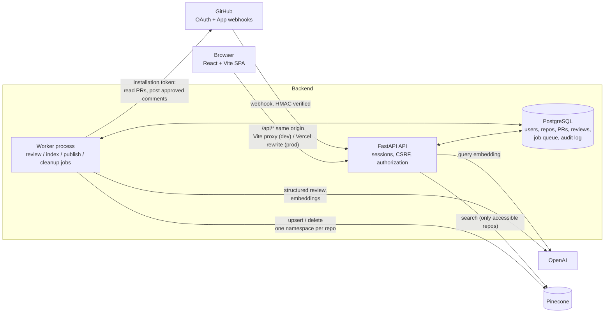
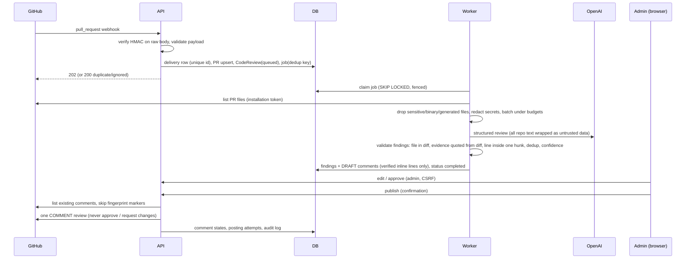

# Architecture

(Diagrams are Mermaid; GitHub, GitLab and VS Code render them. A pre-rendered image could not be produced in the build sandbox.)

## Components

The API never runs a review inside a request: webhooks and "Review this PR" only **persist and enqueue**. The worker claims jobs from the `background_jobs` table, so API and worker can be scaled and restarted independently.

## Review lifecycle

## Job kinds

| Kind | Created by | Handler | Purpose |
|---|---|---|---|
| `review` | webhook, manual request, retry | `workers/review_worker.py` | run the review engine, persist findings and drafts |
| `publish` | review completion, **only if** an admin enabled auto-publish | `workers/publish_worker.py` | approve drafts as the system and publish |
| `index` | push to the default branch, manual request | `workers/indexing_worker.py` | incremental indexing into Pinecone |
| `index_delete` | disconnect, installation/repository removal | `workers/indexing_worker.py` | delete a repository's namespace and index state |

Retries use exponential backoff with jitter; permanent errors (misconfiguration, 4xx) fail fast; expired leases are recovered by any worker; completion is fenced on the worker id so a stalled worker cannot overwrite a newer attempt.

## Request and authorization model

* Identity: GitHub sign-in → server-side session (cookie holds a random token; only its SHA-256 is stored). Unsafe requests also need `X-CSRF-Token` and a permitted `Origin`.
* Authorization is **always** computed on the server from `repository_access` (synced from what GitHub says the user can access through the installation). Missing and forbidden resources both return 404; admin-only actions require `role = owner`, derived from GitHub's `permissions.admin`.
* Tenant isolation in the vector store: namespace `repo-<id>`; the API only queries repositories the caller can access and re-checks `repo_id` in each result.

## Data model (18 tables)

`users`, `oauth_identities` (encrypted token), `user_sessions`, `github_installations`, `repositories`, `repository_access`, `review_configurations`, `review_rules`, `pull_requests`, `webhook_deliveries`, `background_jobs`, `code_reviews`, `review_findings`, `review_comments`, `review_posting_attempts`, `indexing_jobs`, `indexed_files`, `audit_logs`.

Idempotency constraints: `webhook_deliveries.delivery_id`, `code_reviews.dedup_key`, `background_jobs.dedup_key`, `review_findings (review_id, fingerprint)`, `review_comments.finding_id`, `indexed_files (repository_id, path)`.

## Key design decisions

* **DB-backed queue instead of Redis/Celery** — one fewer service, durable by construction; trade-off: polling latency (default 2 s) and Postgres load.
* **Pipeline instead of an agent loop** — bounded cost and no tool use; the model cannot act on injected instructions.
* **Evidence-gated findings** — correct-but-badly-quoted findings are dropped (reported in the summary) rather than risking invented locations.
* **GitHub App + user-to-server token** — repository lists are the intersection of what the user and the installation can access.
* **Drafts by default** — publishing is an explicit, audited, comment-only action.
* **Explicit demo adapters** — mock reviewer and in-memory vector store exist for local use only, are labelled in the UI/API, and are rejected in production.
